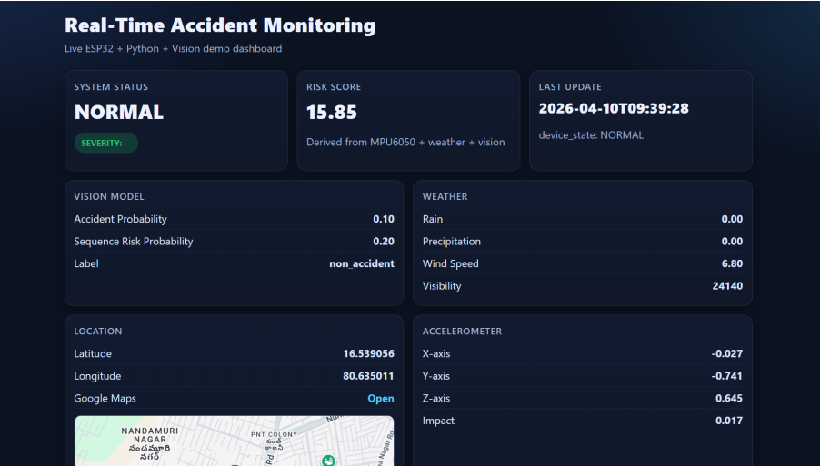
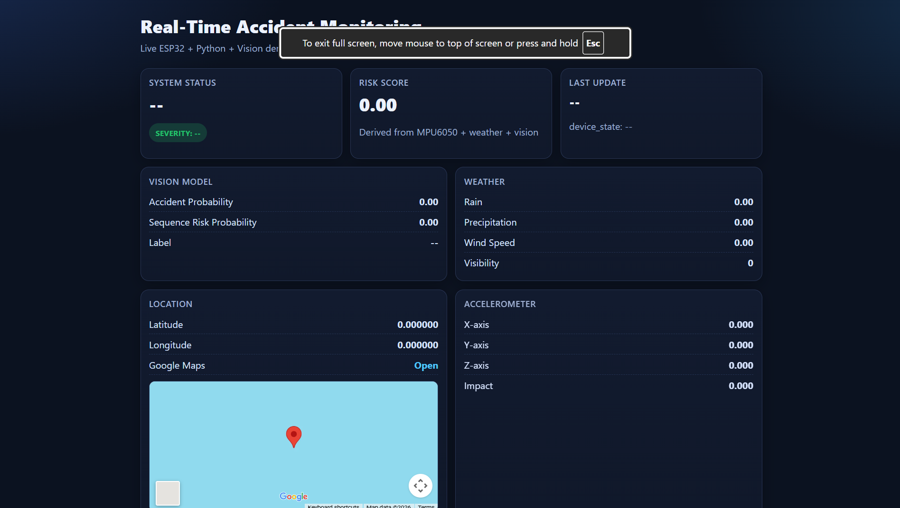
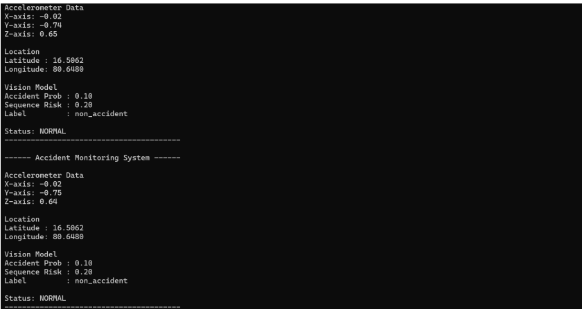
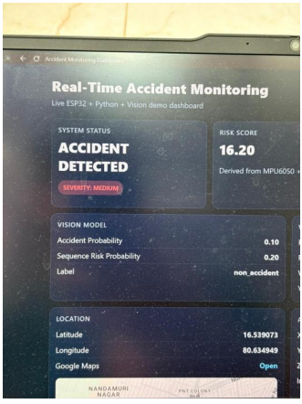
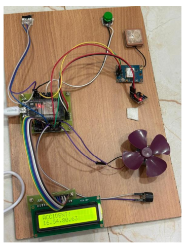
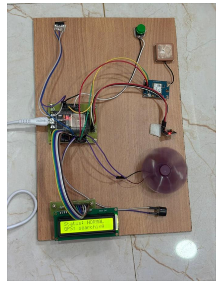
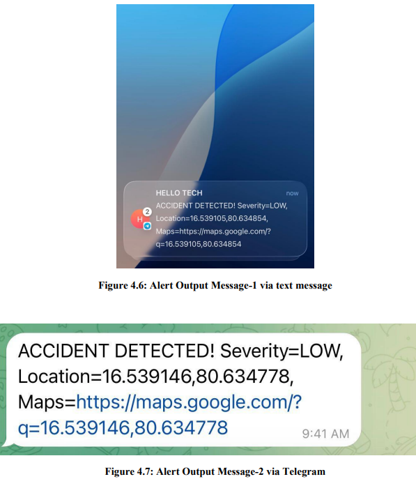

# Real-Time Accident Monitoring and Risk Prediction

An ESP32- and Python-based prototype for monitoring vehicle motion, estimating risk, displaying status on a web dashboard, and sending location-aware alerts. The project combines sensor telemetry, weather information, a vision-data bridge, and emergency notification integrations.

> **Demo note:** The screenshots below show the dashboard and prototype outputs. Some images show sample/demo values. They are not proof that every component is continuously operating in a live deployment. The included `vision_bridge_writer.py` is a demonstration writer; connect your trained DenseNet/LSTM inference pipeline to the vision-state JSON file for actual model inference.

## Dashboard and Project Screenshots

### Dashboard — sample populated view


### Dashboard — initial / no-data view


### Serial-monitor output


### Dashboard photo — accident state example


### ESP32 hardware prototype — accident state


### ESP32 hardware prototype — normal state


### SMS and Telegram alert examples


## System Components

This project has three main software/hardware parts:

- **ESP32 firmware** (`firmware/esp32/esp32_accident_monitor.ino`) for sensor reading and local actuation.
- **Laptop Python app** (`src/laptop_monitor.py`) for telemetry processing, weather lookup, risk analysis, and alert sending.
- **Vision bridge** (`src/vision_bridge_writer.py`) for writing sample vision probabilities to the JSON state file. Replace the demo writer with your trained model pipeline for real inference.
- **Web dashboard** (`src/dashboard.html`) for displaying the latest state from `live_state.json`.

## Hardware Used

- ESP32
- 16x2 LCD (JHD162A, 4-bit mode)
- MPU6050 (I2C)
- NEO-6M GPS
- Active buzzer
- Micro limit switch
- Push button
- Small DC motor (vehicle demo)

## ESP32 Pin Mapping

- LCD RS → GPIO15
- LCD E → GPIO2
- LCD D4 → GPIO4
- LCD D5 → GPIO16
- LCD D6 → GPIO17
- LCD D7 → GPIO5
- Buzzer → GPIO19
- Motor → GPIO23
- MPU6050 SDA → GPIO21
- MPU6050 SCL → GPIO22
- GPS TX → GPIO26 (ESP32 RX2)
- Limit switch output → GPIO18 (HIGH=open, LOW=closed)
- Push button → GPIO33 to GND

Check the wiring against your actual board and firmware before powering the circuit. Use a suitable motor-driver/transistor module and flyback protection; do not drive a motor directly from an ESP32 GPIO pin.

## Requirements

- Windows 10/11
- Python 3.10 or later (Python 3.10 is recommended for compatibility)
- Arduino IDE 2.x for uploading ESP32 firmware
- Google Chrome or another modern browser
- Internet connection for weather lookups and optional alert services
- ESP32 hardware and the listed sensors for the full hardware demonstration

Python packages are listed in `requirements.txt`:

- `pyserial`
- `requests`
- `python-dotenv`

Arduino libraries:

- `TinyGPSPlus`
- `LiquidCrystal` (available by default in many Arduino IDE setups)
- `Wire` (built in)

Depending on the ESP32 board, a CP210x or CH340 USB driver may also be required.

## Setup

Open a terminal in the repository's root directory (the folder containing `README.md`).

### 1. Create and activate a virtual environment

PowerShell:

```powershell
python -m venv .venv
.\.venv\Scripts\Activate.ps1
python -m pip install --upgrade pip
pip install -r requirements.txt
```

If PowerShell blocks activation, you can run the commands without activating the environment by using `.venv\Scripts\python.exe -m pip install -r requirements.txt`.

### 2. Create local configuration

Copy the example environment file:

```powershell
Copy-Item .env.example .env
```

Edit `.env` with your own values. Do not commit `.env` or share real credentials publicly.

Example values (replace placeholders with your own settings):

```env
SERIAL_PORT=COM7
BAUD_RATE=115200
DEFAULT_LAT=16.5062
DEFAULT_LON=80.6480
THINGSPEAK_API_KEY=YOUR_THINGSPEAK_WRITE_KEY
FAST2SMS_API_KEY=YOUR_FAST2SMS_KEY
FAST2SMS_ROUTE=q
SMS_DEBUG=1
DRIVER_PHONE=91XXXXXXXXXX
EMERGENCY_PHONES=91XXXXXXXXXX,91YYYYYYYYYY
TELEGRAM_BOT_TOKEN=YOUR_TELEGRAM_BOT_TOKEN
TELEGRAM_CHAT_IDS=YOUR_CHAT_ID
VISION_STATE_FILE=vision_state.json
LIVE_STATE_FILE=live_state.json
```

`src/laptop_monitor.py` loads `.env` through `python-dotenv`. The COM port must match the ESP32 port shown in Windows Device Manager. Optional alert services require valid credentials and configuration.

## Run the Project

### Option A: Start the demo launcher

From the repository root, run:

```powershell
.\scripts\launch_demo.bat
```

If that launcher is not present in your current checkout, use the manual steps below and check the `scripts/` folder for the available launcher names.

### Option B: Run manually

1. Upload `firmware/esp32/esp32_accident_monitor.ino` to the ESP32 using Arduino IDE.
2. Close Arduino Serial Monitor after uploading so it releases the COM port.
3. Ensure `vision_state.json` and `live_state.json` are created in the paths configured in `.env`; sample JSON files are provided in `examples/` for reference.
4. From the repository root, start the Python monitor:

```powershell
python .\src\laptop_monitor.py
```

5. Start a local web server from the `src` folder in a second terminal:

```powershell
cd .\src
python -m http.server 8080
```

6. Open the dashboard in a browser:

```text
http://127.0.0.1:8080/dashboard.html
```

The dashboard polls `live_state.json` once per second. Ensure the runtime JSON file is in the same directory served by the web server, or adjust the dashboard/configuration paths to match your setup. Do not assume the dashboard is receiving live data just because the page opens.

## Vision Bridge Data Format

The vision state JSON is expected to contain fields similar to:

```json
{
  "accident_prob": 0.0,
  "sequence_risk_prob": 0.0,
  "label": "non_accident",
  "updated_at": "2026-03-07T11:00:00"
}
```

- `accident_prob`: image/frame accident probability, from 0 to 1.
- `sequence_risk_prob`: temporal sequence risk probability, from 0 to 1.
- `label`: current class label.
- `updated_at`: timestamp for the last update.

For a demonstration state writer, run:

```powershell
python .\src\vision_bridge_writer.py
```

This generates demo values; it is not a substitute for loading and running a trained DenseNet/LSTM model.

## Expected Behavior

- **Normal mode:** the LCD and Python output report normal status when the input conditions are normal.
- **Risk warning:** the application may trigger a pre-alert and configured notification or ThingSpeak update when its risk conditions are met.
- **Accident detected:** severe motion, a limit-switch event, or a high risk score may trigger local outputs and configured alerts, including a Google Maps link when GPS coordinates are available.

Actual behavior depends on correct wiring, firmware, serial-port configuration, state-file paths, network access, and valid API credentials. Test alerts carefully and do not treat this prototype as a certified vehicle safety system.

## Telegram Setup (Optional)

1. In Telegram, message `@BotFather`.
2. Create a bot using `/newbot`.
3. Put the bot token in `.env` as `TELEGRAM_BOT_TOKEN`.
4. Send a message to your bot from your Telegram account.
5. Open `https://api.telegram.org/bot<YOUR_BOT_TOKEN>/getUpdates` in a browser, replacing the placeholder with your token. Keep the token private.
6. Find your chat ID and add it to `.env` as `TELEGRAM_CHAT_IDS`. Multiple IDs may be comma-separated if supported by your configuration.

## Repository Structure

```text
.
├── docs/
│   ├── TEAM_SETUP_AND_SHARING.md
│   ├── conference-paper.pdf
│   ├── project-presentation.pptx
│   └── project-report.pdf
├── examples/
│   ├── live_state.sample.json
│   └── vision_state.sample.json
├── firmware/
│   └── esp32/
│       └── esp32_accident_monitor.ino
├── screenshots/
├── scripts/
├── src/
│   ├── dashboard.html
│   ├── laptop_monitor.py
│   └── vision_bridge_writer.py
├── .env.example
├── .gitignore
├── README.md
└── requirements.txt
```

## Team

This repository is for the final-year project **Real-Time Accident Monitoring and Risk Prediction**. Please keep the team-member names, guide name, and institute details consistent with the approved project report and presentation in `docs/`.

## Safety and Privacy Notes

- Never commit `.env`, real API keys, Telegram bot tokens, or private chat IDs.
- Do not publish personal phone numbers or sensitive location data in screenshots or sample files.
- Use a motor driver/transistor and appropriate protection components for the DC motor.
- This is an academic prototype and is not a replacement for certified automotive safety equipment.
